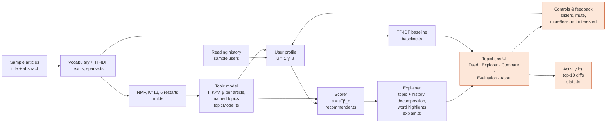

# Architecture

Everything runs client-side. The engine (`src/engine/`) has no React dependency, so the same code serves the UI, the tests and the MIND evaluation CLI.

Orange nodes are TopicLens additions.

## Data flow for one action

1. A user clicks e.g. **Mute "Health & Medicine"**.
2. `state.ts` computes the current top 10, applies the action to the user's `Preferences`, and recomputes the top 10.
3. It writes a log entry with the computed difference.
4. The new state is persisted to `localStorage`.
5. `App.tsx` recomputes `recommend()` (TopicLens), `recommend()` with default prefs (for Compare) and `baselineRecommend()`.
6. All pages re-render from the new context.

## Module responsibilities

| Module | Responsibility |
|---|---|
| `text.ts` | Tokeniser, stopwords, corpus-driven plural merge, DF-filtered vocabulary, display segmentation |
| `sparse.ts` | CSR matrices, TF-IDF |
| `nmf.ts` | Seeded PRNG, sparse multiplicative-update NMF, reconstruction error |
| `topicModel.ts` | Fit (with restarts), T and β, descriptors, rule-based naming, word highlighting |
| `recommender.ts` | Profile (γ, feedback, multipliers), candidate filtering, scoring, exact decompositions |
| `baseline.ts` | TF-IDF cosine baseline |
| `explain.ts` | Template sentences from computed values; limitations text |
| `metrics.ts` | AUC, MRR, nDCG@k (MIND definitions), NPMI (Eq. 17), overlap@k |
| `mind.ts` / `scripts/eval-mind.ts` | MIND TSV parsing and offline evaluation |
| `state.ts` | Per-user state, actions, change log, persistence |
