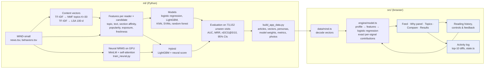

# Architecture

Two halves: an offline **ML pipeline** in Python (`ml/`) that trains and evaluates every model on MIND, and a
**browser app** in React + TypeScript (`src/`) that runs the trained logistic regression on exported data.

Blue nodes are TopicLens additions beyond the paper.

## ML pipeline (`ml/`)

| Script | What it does | Output |
|---|---|---|
| `train_neural.py` | Encodes every article with MiniLM (GPU), trains an NRMS-style user encoder on 189,519 clicks, keeps the best epoch by validation AUC, writes per-candidate scores | `ml/results/neural.json`, `.dataset-cache/nrms_scores.npy` |
| `train.py` | Builds topic and LSA vectors (cached), features for 8.58M candidate rows, trains every model, evaluates all of them with bootstrap CIs | `ml/results/metrics.json`, `logreg.json`, `lgbm_model.txt` |
| `build_app_data.py` | Exports 1,500 dev-day articles + demo readers' histories, quantised vectors, the logistic regression, metrics, human topic names and Wikimedia photos | `src/data/mind-app.json`, `public/showcase/` |

**Leakage rules.** No feature uses the label of its own row. Popularity uses clicks from strictly earlier days of the
training log only; exposure and "first seen" use impression times, never labels. The hybrid is trained on the last
training day, which the neural model never saw.

## App (`src/`)

| Module | Responsibility |
|---|---|
| `data/mind.ts` | Loads `mind-app.json`, decodes the quantised topic and text vectors, category names, cold-start seeding |
| `engine/model.ts` | Reader profile (mean of the last 50 reads, as in training), features, the logistic regression, exact contributions, per-history-article evidence, controls (sliders, mutes, More/Less, Not interested), baselines |
| `engine/explain.ts` | Plain-language sentences filled from the computed contributions (labelled "template text") |
| `state.ts` | Per-account history, preferences and activity log (top-10 diffs), saved in localStorage |
| `auth.ts` | Accounts: Google Identity Services, email, guest, demo reader; localStorage only |
| `pages/` | Landing, onboarding, feed, Topics, Compare, Results, About |
| `components/sketch.tsx` | Newsprint doodles (circles, underlines, arrows) and the torn-paper SVG filter |

## Data flow for one action

1. A reader clicks **Mute** on "2020 election".
2. `state.ts` ranks the current top 10, applies the change, and ranks again.
3. The difference is written to the activity log and the state is saved to localStorage.
4. `App.tsx` recomputes `recommend()`; stories at least 25% about the muted topic are hidden with their reason.
5. Every page re-renders from the new result.
